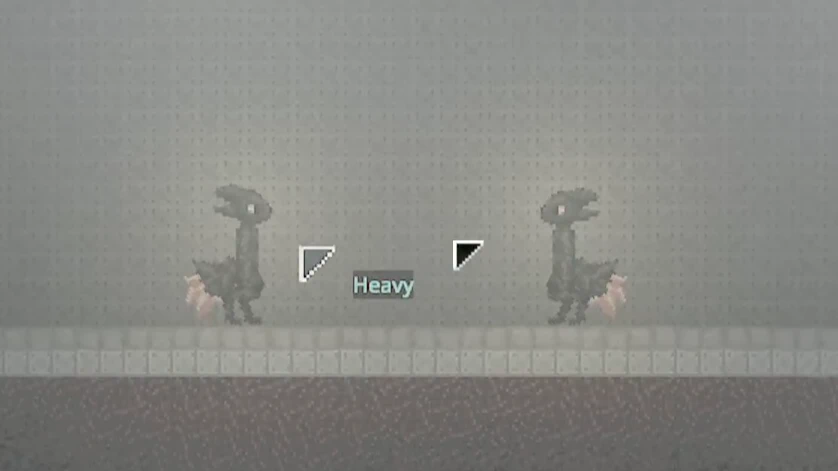

# MultiPlayerCursor

A mod for **Casualties Unknown** that displays the in-world cursors of other players in a multiplayer session. This helps you see where your teammates are looking and pointing.

## Features

- Client-side (Only those who have the mod see the cursor)
- Displays the in-world cursor of other players.
- Hides a player's cursor if they have tabbed out or died.
- In PvP, opponent cursors are hidden.
- In team PvP, only teammates' cursors are displayed.
- Shows the name of every player's cursor
- Has a hotkey to disable the mod (F2).

## Requirements

- The latest version of BepInEx
- [Multiplayer mode](https://github.com/creaturefeaturelarry/casualties-together)
- [CUCore](https://github.com/jimmyking9999999/CUCoreLib)

## Installation

1. Install BepInEx for Casualties: Unknown.
2. Launch the game once with BepInEx installed.
3. Install Casualties Together / Multiplayer mode.
4. Download the MultiPlayerCursor archive.
5. Extract the archive into your BepInEx plugins folder.
6. Start the game and join or host a multiplayer session.

After installation, the file should be located at: `BepInEx/plugins/OnlineCursor/OnlineCursor.dll`
